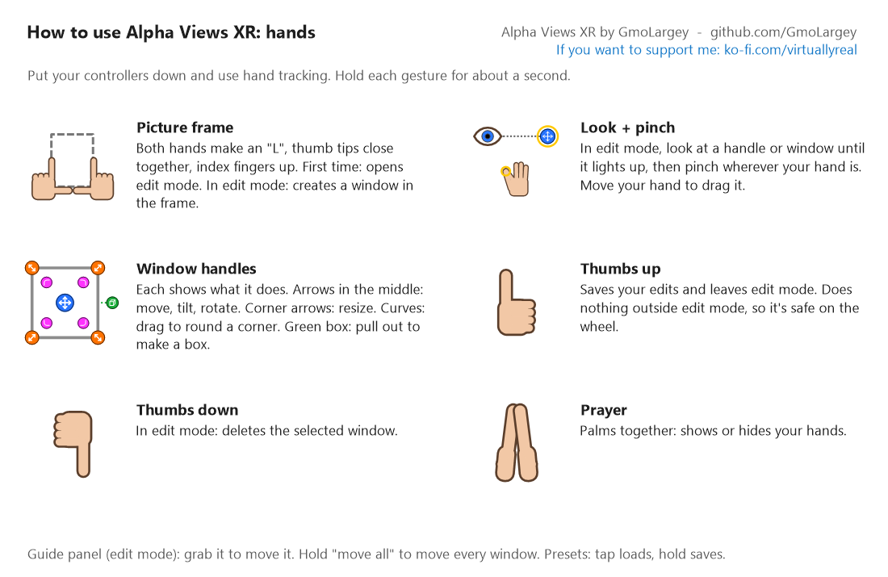
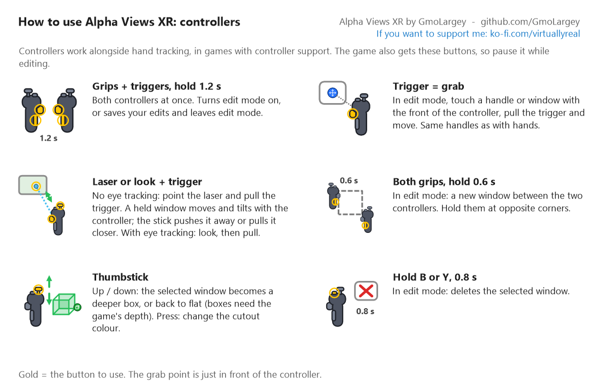
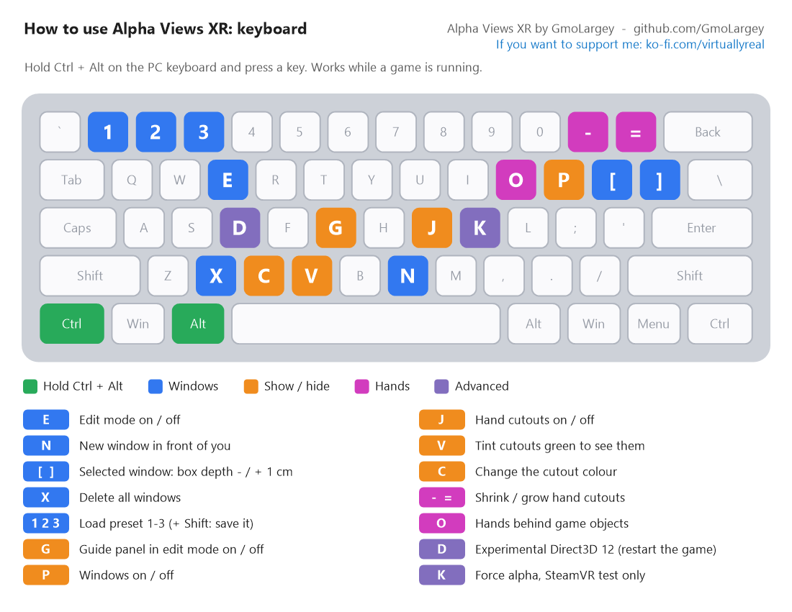
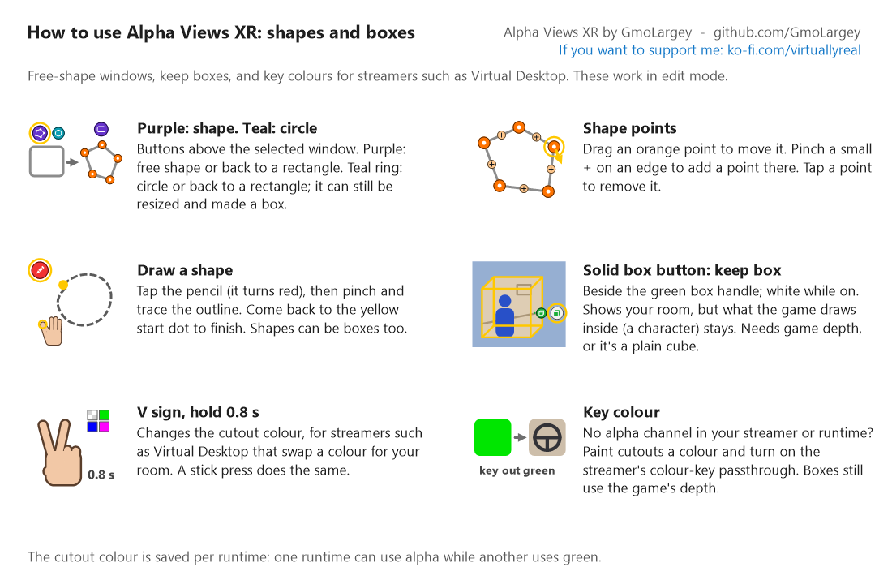

# Alpha Views XR

**See your real hands, steering wheel and flight controls inside PC VR games.**

Alpha Views XR is an OpenXR API layer that cuts see-through sections into PC VR games, so your
headset's passthrough camera shows your real room there. It works with the runtime's alpha
channel where supported, or with green / blue / pink colour-key passthrough (e.g. Virtual
Desktop). With games that share their depth, windows become 3D boxes and your hands hide behind
game objects correctly. Everything is set up in the headset with hand tracking, controllers or
the keyboard.

[Download](../../releases) · [User guide](packaging/README.txt) · [Building from source](#building-from-source) · [Support me on Ko-fi](https://ko-fi.com/virtuallyreal)

---

## Features

- **Hand cutouts:** your tracked hands show as passthrough, tight to the hand.
- **Windows:** place rectangles, circles or free shapes around your wheel, shifter, button box
  or HOTAS. Move, tilt, resize and round the corners. Up to 32 per game, saved per game.
- **Depth boxes:** pull a window into a box, and only the game's surfaces *inside* the box turn
  to passthrough. Put one around your wheel to see your real wheel and hands, while the game's
  dials behind it stay visible.
- **Keep boxes:** the opposite. The box shows your room, but whatever the game draws inside it
  (a character, a cockpit display) stays.
- **Hands behind objects:** game surfaces closer than your hand cover it.
- **Alpha or colour key:** transparent cutouts on runtimes with an alpha channel, or cutouts
  painted green, blue or pink for streamers with colour-key passthrough. Saved per runtime.
- **Three ways to edit:** hand gestures, controllers (with a laser for headsets without eye
  tracking), or keyboard shortcuts. An in-headset guide panel shows the controls.
- **Presets:** save and restore three window layouts per game.
- **Wide game support:** Direct3D 11 OpenXR games, 64-bit and 32-bit. Direct3D 12 is
  experimental (Ctrl+Alt+D).
- **Test scene included:** a spinning cube to check passthrough, depth and hands before you play.

## Controls

| Hand gestures | Controllers |
| :---: | :---: |
|  |  |
| **Keyboard (Ctrl + Alt + key)** | **Shapes, boxes and colours** |
|  |  |

## Requirements

- Windows 10/11, 64-bit, and a headset with passthrough that streams PC VR.
- A game that runs in **OpenXR** mode with **Direct3D 11** (Direct3D 12 experimental).
  Vulkan and OpenGL games aren't supported. SteamVR-only (OpenVR) games don't work, because
  SteamVR removes the transparency.
- A streamer or runtime with an **alpha channel** option, or with **colour-key passthrough**
  (e.g. Virtual Desktop).
- Boxes, keep boxes and hands behind objects need the game to send its depth
  (`XR_KHR_composition_layer_depth`). The guide panel shows whether it does.

## Getting started

1. Download `AlphaViewsXR-Setup-<version>.exe` from [Releases](../../releases) and run it.
   (Or extract the zip somewhere permanent and run `Install.bat`.)
2. Check the right OpenXR runtime is selected, and that Alpha Views XR is **On** under
   *Manage OpenXR API Layers* (SteamVR Settings > OpenXR shows both).
3. Turn on your streamer's alpha option, or its colour-key passthrough and pick the same colour
   in Alpha Views XR with **Ctrl+Alt+C**.
4. Try the test scene first (Start menu: *Alpha Views XR test scene*).
5. In a game: open **edit mode** with a picture-frame gesture, both grips + triggers, or
   **Ctrl+Alt+E**. Frame your wheel to make a window, adjust it with its handles, then give
   a thumbs up to save.

The full guide, including troubleshooting, is in [packaging/README.txt](packaging/README.txt).

> **Safety:** Alpha Views XR can fail or show the wrong area at any time (for example if
> tracking is lost). Don't rely on it to keep you safe; keep your play area clear. Some games,
> online services and anti-cheat systems don't allow programs that change what a game shows,
> so check first.

## Building from source

**You need:** Visual Studio 2022 with *Desktop development with C++* (MSVC and the Windows
10/11 SDK, which provides `fxc.exe`), CMake 3.20+, and Git. Inno Setup 6 is needed only for the
installer.

Build everything (64-bit and 32-bit layers, test scene, zip, installer and source package
in `dist\`):

```powershell
.\package.ps1
```

Or just the 64-bit layer:

```powershell
.\packaging\gen_gestures.ps1     # once: draws packaging\gestures\*.bmp, used by guide_icons.rc
cmake -S . -B build -A x64
cmake --build build --config Release
.\install.ps1                    # registers build\Release for the current user (-Machine: all users)
```

For the 32-bit layer, use `-A Win32` and a separate folder (`build32`). CMake downloads the
OpenXR SDK headers itself. The version number lives only in `CMakeLists.txt`.

### Project layout

| Path | What it is |
| --- | --- |
| `layer.cpp` | The layer: OpenXR hooks, hand and controller input, windows and boxes, edit mode, Direct3D 11 drawing, Direct3D 12 through D3D11On12 |
| `shaders.hlsl` | Shaders, compiled by `fxc` into headers at build time |
| `version.rc`, `guide_icons.rc` | DLL version info and the guide panel pictures |
| `XR_APILAYER_GMO_alpha_views_xr.json` | OpenXR layer manifest |
| `test_scene/` | `AlphaViewsXRTest.exe`, the OpenXR test scene |
| `packaging/` | Inno Setup script, zip install scripts, user guide, licence files, and `gen_gestures.ps1`, which draws all the control pictures |
| `package.ps1` | Builds and packages everything |

## Licence

Copyright (C) 2026 GmoLargey.

Alpha Views XR is free software under the **GNU General Public License version 3**
(GPL-3.0-only): see [LICENSE](LICENSE). You may use, share and change it. If you share a changed
version, you must share its source under the same licence. Please give it a different name and
OpenXR layer name (`XR_APILAYER_<you>_...`) so it can't be confused with, or clash with, the
official layer.

The test scene links the Khronos OpenXR loader (Apache-2.0) and JsonCpp (MIT): see
[THIRD_PARTY_NOTICES.txt](packaging/THIRD_PARTY_NOTICES.txt). Names of games, headsets,
streaming apps and runtimes belong to their owners; Alpha Views XR isn't made, endorsed or
supported by any of them.

## Support

If Alpha Views XR is useful to you, you can support me on
[Ko-fi](https://ko-fi.com/virtuallyreal). Bug reports are welcome in [Issues](../../issues):
please attach `%LOCALAPPDATA%\AlphaViewsXR\log.txt` from the game that had the problem.
